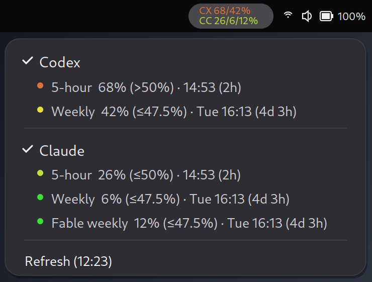
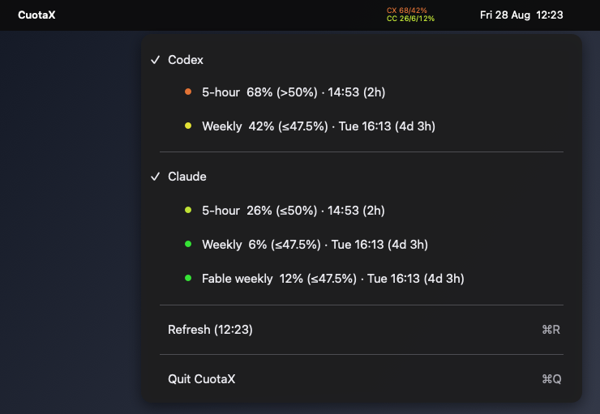
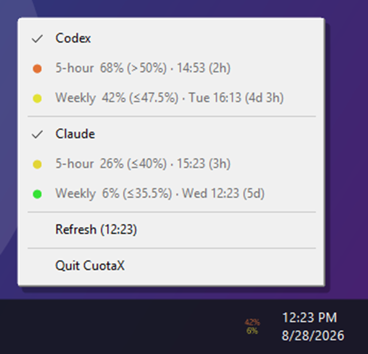

# CuotaX

A minimal GNOME Shell extension, native macOS menu-bar app, and native Windows
notification-area app that show the highest active Codex or Claude quota
percentage. The menu shows the 5-hour and weekly quotas with local reset times.

| GNOME                                                                                            | macOS                                                                                           | Windows                                                                                                        |
| ------------------------------------------------------------------------------------------------ | ----------------------------------------------------------------------------------------------- | -------------------------------------------------------------------------------------------------------------- |
| [](.github/screenshots/gnome.png) | [](.github/screenshots/macos.png) | [](.github/screenshots/windows.png) |

Enable Codex, Claude, or both using the menu checkboxes. CuotaX remembers the
enabled providers. GNOME and macOS combine them in one indicator with stacked
percentages; Windows shows a separate indicator for each. Every menu groups the
limits, update time, and errors beneath each provider's checkbox. Each provider
refreshes independently and has its own quota, errors, and reset notifications.
At least one provider stays enabled so its menu remains accessible.

Every five minutes and at known reset times, CuotaX reads Codex quota through
`account/rateLimits/read` from the experimental Codex app-server interface using
`codex app-server --stdio`. This does not start a model turn or consume quota.
CuotaX sends a desktop notification when a known 5-hour or weekly quota window
resets.

For Claude, CuotaX prefers status-line data from the last five minutes, then
falls back to the undocumented Claude Code OAuth usage endpoint using the
existing login. It reads credentials from the macOS Keychain or
`~/.claude/.credentials.json` on Linux and Windows, and supports
`CLAUDE_CONFIG_DIR` and `CLAUDE_CODE_OAUTH_TOKEN`. On Linux, CuotaX automatically
renews the saved Claude Code login in the background and saves rotated tokens
back to the credential file. Log in again only if the saved login cannot be
renewed. On macOS and Windows, open Claude Code to renew an expired login.
Neither backend starts a model turn.

## Requirements

- Codex CLI, logged in with ChatGPT, or Claude Code, logged in with a Claude subscription
- GNOME Shell: GNOME Shell 50, `gnome-extensions`, Node.js, and npm
- macOS: macOS 13 or newer and Swift 6.0 or newer
- Windows: .NET 10 SDK
- Development checks and the optional Claude status-line bridge: Node.js

## Usage

```sh
make install
make uninstall
```

Run `make help` to see all available commands.

### Claude status-line bridge

Polling works without additional configuration. To reduce network requests
while Claude Code is active, configure its
[status line](https://code.claude.com/docs/en/statusline) to run the bundled
`claude-statusline.mjs` with Node.js. Add a `statusLine` entry to your Claude
settings, replacing the command with the appropriate path:

```json
{
  "statusLine": {
    "type": "command",
    "command": "node \"/absolute/path/to/claude-statusline.mjs\""
  }
}
```

The installed bridge is located at:

- GNOME: `~/.local/share/gnome-shell/extensions/cuotax@jpnurmi.github.com/claude-statusline.mjs`
- macOS: `~/Applications/CuotaX.app/Contents/Resources/claude-statusline.mjs`
- Windows: `%LOCALAPPDATA%\Programs\CuotaX\claude-statusline.mjs`

The bridge displays Claude quota usage and atomically writes only usage
percentages, reset times, and an update timestamp to
`~/.claude/cuotax-usage.json` (or under `CLAUDE_CONFIG_DIR`). CuotaX reads this
file immediately when it changes. When Claude stops supplying updates, polling
resumes after five minutes. Idle sessions also fall back to polling once their data is stale.
If you already use a custom status line, pass the same stdin JSON to both the
bridge and your existing command.

## Notes

- GNOME Shell: After the first installation on Wayland, log out and back in,
  then run `make enable`.
- macOS: The app has no Dock icon and registers itself as a login item when it
  launches.
- Windows: The app registers itself to start with Windows when it launches. The
  app shows one tray icon per enabled provider, identified by its tooltip. Each
  icon shows that provider's highest active quota as a two-digit overlay. Exhausted
  quota is shown as a deep-red `×`, while backend or authentication failures use
  a distinct `!` icon.

The protocol and rate-limit fields are documented in the
[Codex App Server documentation](https://learn.chatgpt.com/docs/app-server#6-rate-limits-chatgpt).
